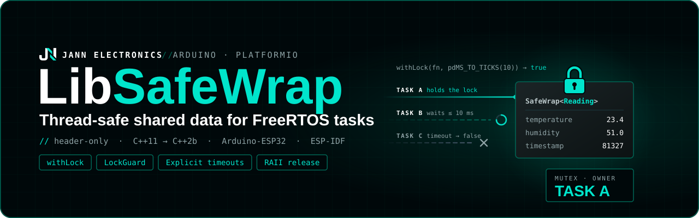

<p align="center">
  
</p>

# LibSafeWrap

Thread-safe access to structs, arrays and objects shared between FreeRTOS tasks on the ESP32.

```cpp
struct Reading { float temperature; float humidity; uint32_t timestamp; };

SafeWrap<Reading> reading;

bool ok = reading.withLock([](Reading& r) {
  r.temperature = 23.4f;
  r.humidity    = 51.0f;
  r.timestamp   = millis();
}, pdMS_TO_TICKS(10));
```

`SafeWrap<T>` keeps a value and a FreeRTOS mutex together. The value is private: the only way
to read or write it is through an operation that takes the mutex first and releases it
afterwards, on every exit path.

- Single header, header-only (`src/SafeWrap.h`, ~160 lines).
- Every operation takes an **explicit timeout** and returns whether it got the lock.
- The mutex is always released, including on `return` and exceptions (RAII).
- Works with Arduino-ESP32 2.x (C++11) and 3.x (C++2b), and ESP-IDF.

## Contents

- [LibSafeWrap](#libsafewrap)
  - [Contents](#contents)
  - [SafeWrap or std::atomic?](#safewrap-or-stdatomic)
    - [Side by side](#side-by-side)
    - [What `std::atomic` really compiles to on the ESP32](#what-stdatomic-really-compiles-to-on-the-esp32)
    - [When `SafeWrap` is the right choice even for a small type](#when-safewrap-is-the-right-choice-even-for-a-small-type)
  - [Installation](#installation)
  - [API](#api)
    - [Constants](#constants)
    - [Constructors](#constructors)
    - [`bool get(T& out, TickType_t timeout) const`](#bool-gett-out-ticktype_t-timeout-const)
    - [`bool set(const T& value, TickType_t timeout)` / `bool set(T&& value, TickType_t timeout)`](#bool-setconst-t-value-ticktype_t-timeout--bool-sett-value-ticktype_t-timeout)
    - [`bool withLock(Func&& func, TickType_t timeout)`](#bool-withlockfunc-func-ticktype_t-timeout)
    - [`LockGuard getLock(TickType_t timeout)`](#lockguard-getlockticktype_t-timeout)
    - [`[[nodiscard]]`](#nodiscard)
  - [What happens when the timeout expires](#what-happens-when-the-timeout-expires)
  - [Choosing a timeout](#choosing-a-timeout)
  - [withLock or LockGuard?](#withlock-or-lockguard)
  - [Protecting a driver object](#protecting-a-driver-object)
  - [Rules and pitfalls](#rules-and-pitfalls)
  - [Costs](#costs)
  - [Examples](#examples)
  - [License](#license)

## SafeWrap or std::atomic?

**Short answer:** a single small value (counter, flag, last reading) → `std::atomic`. A struct,
an array, an object, or several values that must stay consistent with each other → `SafeWrap`.

SafeWrap accepts any type, including `int` or `bool`; nothing prevents it. The recommendation
exists because for a lone primitive, `std::atomic` is smaller, faster and cannot fail.

### Side by side

|                         | `std::atomic<uint32_t>`         | `SafeWrap<uint32_t>`                                                                   |
| ----------------------- | ------------------------------- | -------------------------------------------------------------------------------------- |
| Object size             | 4 bytes                         | 8 bytes (value + mutex handle)                                                         |
| Extra heap              | none                            | one FreeRTOS mutex: 92 bytes (core 3.x) / 84 bytes (core 2.x), plus allocator overhead |
| `load` / `store`        | one memory instruction          | kernel call: take mutex, copy, give mutex                                              |
| `++` / `fetch_add`      | see table below                 | kernel call: take mutex, modify, give mutex                                            |
| Can fail?               | no                              | yes, returns `false` on timeout                                                        |
| Usable from an ISR?     | yes                             | **no** (asserts)                                                                       |
| Waiting task blocks?    | never blocks                    | sleeps until the mutex is free or the timeout expires                                  |
| Priority inheritance    | not applicable                  | yes                                                                                    |
| Read-decide-write logic | needs a `compare_exchange` loop | plain code inside `withLock`                                                           |

The mutex sizes are `sizeof(StaticSemaphore_t)`, measured at compile time on each core.
`xSemaphoreCreateMutex()` allocates one block of that size from the heap, and the heap allocator
adds a few bytes of bookkeeping per block (more if heap poisoning is enabled).

### What `std::atomic` really compiles to on the ESP32

`std::atomic` is not always a single instruction. This was verified by disassembling the
generated code with each toolchain (Arduino-ESP32 3.3.7 / ESP-IDF 5.5, and Arduino-ESP32
2.0.14 / ESP-IDF 4.4):

| Operation                                            | ESP32 / ESP32-S3, core 2.x                  | ESP32 / ESP32-S3, core 3.x                                                                                                                | ESP32-C3, core 3.x                                                                          |
| ---------------------------------------------------- | ------------------------------------------- | ----------------------------------------------------------------------------------------------------------------------------------------- | ------------------------------------------------------------------------------------------- |
| `load()` / `store()`, up to 32 bits                  | inline: one load or store + `memw` barrier  | inline: same                                                                                                                              | inline: one load or store                                                                   |
| `++`, `fetch_add`, `compare_exchange`, up to 32 bits | inline hardware compare-and-swap (`s32c1i`) | function call `__atomic_fetch_add_4`: hardware `s32c1i` if the variable is in internal RAM, spinlock + critical section if it is in PSRAM | function call: interrupts masked for a few instructions (the C3 has no atomic instructions) |
| Any operation on 64-bit types (`uint64_t`, `double`) | function call                               | function call: spinlock + critical section                                                                                                | function call                                                                               |

What this means in practice:

- **Loads and stores of values up to 32 bits are always cheap.** A flag or a "latest value"
  written by one task and read by others is the ideal `std::atomic` use case.
- **On core 3.x, `++` costs a function call** instead of an inline instruction. That is still
  far cheaper than taking a FreeRTOS mutex, and it never blocks.
- **64-bit atomics use a short critical section** internally. They are still correct and never
  block the task, but they are no longer "free".
- `std::atomic<T>::is_always_lock_free` reports `false` for every type on core 3.x, because the
  library may fall back to a lock (PSRAM, C3). This does not mean ordinary use in internal RAM
  takes a lock.

### When `SafeWrap` is the right choice even for a small type

1. **Read-decide-write logic.**
   `level.withLock([](int& n) { n = (n < 100) ? n + 10 : 0; }, t);` is trivial. With
   `std::atomic` it needs a `compare_exchange` retry loop.
2. **Several values that must stay consistent.** Two separate atomics can be read "half
   updated" (`x` from the new update, `y` from the old one). Put them in one struct under one
   `SafeWrap`.
3. **The value is likely to grow into a struct.**

## Installation

**PlatformIO** (Arduino or ESP-IDF framework), in `platformio.ini`:

```ini
lib_deps = https://github.com/JojeNN97/lib-SafeWrap.git
```

**Anything else**: copy `src/SafeWrap.h` into your project. It only includes `<utility>`,
`freertos/FreeRTOS.h` and `freertos/semphr.h`.

```cpp
#include <SafeWrap.h>
```

## API

### Constants

```cpp
SafeWrap<T>::NO_WAIT       // 0: a single attempt, never blocks
SafeWrap<T>::WAIT_FOREVER  // portMAX_DELAY: block until the mutex is free
```

Any other timeout is given in ticks, usually with `pdMS_TO_TICKS(ms)`.

### Constructors

```cpp
SafeWrap<T> w;               // value-initialized T{} (zeroes a plain struct)
SafeWrap<T> w(initialValue); // copies initialValue
SafeWrap<T> w(T{...});       // moves a temporary (no copy for String, std::vector...)
```

Each constructor creates the mutex with `xSemaphoreCreateMutex()` and calls
`configASSERT(mutex)`: if the heap is exhausted, the program stops at startup instead of failing
later.

A `SafeWrap` **cannot be copied or moved**. Two copies would share one mutex handle and both
would delete it. Declare it as a global, a `static`, or a class member.

### `bool get(T& out, TickType_t timeout) const`

Copies the whole value into `out`.

```cpp
Reading snap;
if (reading.get(snap, pdMS_TO_TICKS(10))) {
  show(snap);  // use the copy outside the lock
}
```

### `bool set(const T& value, TickType_t timeout)` / `bool set(T&& value, TickType_t timeout)`

Replaces the whole value. The `T&&` overload moves instead of copying.

```cpp
if (!reading.set(Reading{20.0f, 40.0f, millis()}, pdMS_TO_TICKS(10))) {
  log_w("reading not stored: timeout");
}
```

### `bool withLock(Func&& func, TickType_t timeout)`

Calls `func(T&)` while holding the mutex. This is the main operation: read some fields, modify
others, or both, in one critical section.

```cpp
// Read two fields without copying the whole struct
float t = 0;
bool active = false;
bool ok = sensor.withLock([&](const Sensor& s) {
  t      = s.temperature;
  active = s.active;
}, pdMS_TO_TICKS(10));

// Read, decide and modify atomically
ok = sensor.withLock([](Sensor& s) {
  if (s.temperature > 30.0f) s.active = false;
}, pdMS_TO_TICKS(10));
```

Calling it on a `const SafeWrap<T>&` passes `const T&`, so the lambda can only read. Use this to
hand a `SafeWrap` to code that must not modify it.

### `LockGuard getLock(TickType_t timeout)`

Returns a `LockGuard`: an object that holds the mutex for as long as it exists and releases it
automatically when it goes out of scope.

```cpp
auto lock = sensor.getLock(pdMS_TO_TICKS(10));
if (!lock) return;           // timeout: nothing to release

lock->temperature = 25.0f;   // access the value through ->
if (lock->active) return;    // released here automatically
lock.unlock();               // or release early, explicitly

vTaskDelay(pdMS_TO_TICKS(100));  // the mutex is already free
```

| Member                                 | Description                                                             |
| -------------------------------------- | ----------------------------------------------------------------------- |
| `isLocked()`, `explicit operator bool` | whether the mutex was acquired                                          |
| `get()`, `operator*`, `operator->`     | access the value; `configASSERT` if not locked                          |
| `unlock()`                             | release before the end of the scope; afterwards `isLocked()` is `false` |

A `LockGuard` can be moved (that is how `getLock()` returns it) but not copied. Only one owner
ever releases the mutex.

### `[[nodiscard]]`

With C++17 or newer (Arduino-ESP32 3.x), `get`, `set`, `withLock` and `getLock` are
`[[nodiscard]]`: ignoring the result produces a compiler warning. When ignoring it is
intentional, say so with `(void)`:

```cpp
(void)stats.withLock([](Stats& s) { ++s.samples; }, SafeWrap<Stats>::WAIT_FOREVER);
```

On C++11 (Arduino-ESP32 2.x) the attribute does not exist and there is no warning.

## What happens when the timeout expires

**Nothing is modified, and no default value is produced.** The operation returns `false`
and leaves everything as it was:

| Operation        | On timeout                                           |
| ---------------- | ---------------------------------------------------- |
| `get(out, t)`    | returns `false`; `out` keeps its previous content    |
| `set(v, t)`      | returns `false`; the protected value is unchanged    |
| `withLock(f, t)` | returns `false`; `f` is **not called**               |
| `getLock(t)`     | returns an empty `LockGuard`: `if (lock)` is `false` |

Because `out` is left untouched, **you** choose the fallback when you initialize it:

```cpp
Config cfg{};                                   // fallback: defaults
(void)config.get(cfg, pdMS_TO_TICKS(10));

static Reading last{};                          // fallback: last good value
if (!reading.get(last, pdMS_TO_TICKS(10))) log_w("using previous reading");

float t = NAN;                                  // fallback: "unknown"
(void)sensor.withLock([&](const Sensor& s) { t = s.temperature; }, pdMS_TO_TICKS(10));
```

This is the same contract as FreeRTOS itself: `xQueueReceive(queue, &out, timeout)` only writes
`out` when it returns `pdTRUE`.

## Choosing a timeout

There is deliberately no default timeout. A short hidden default fails silently under load, and
a hidden `portMAX_DELAY` turns a deadlock into a task that hangs forever without any sign.

```cpp
state.set(v, SafeWrap<State>::NO_WAIT);       // try once, move on if busy
state.set(v, pdMS_TO_TICKS(10));              // typical short operation
state.set(v, pdMS_TO_TICKS(500));             // the caller can tolerate a delay
state.set(v, SafeWrap<State>::WAIT_FOREVER);  // only with a good reason
```

A few milliseconds is usually enough for a short critical section to get the mutex under normal
contention, and short enough not to hide a hang. If the same value repeats across your code,
define it once:

```cpp
static const TickType_t kLockTimeout = pdMS_TO_TICKS(10);
```

Arduino-ESP32 runs FreeRTOS at 1000 Hz (1 tick = 1 ms). ESP-IDF projects default to 100 Hz,
where `pdMS_TO_TICKS(5)` rounds down to 0 ticks, which means `NO_WAIT`.

## withLock or LockGuard?

They do the same thing: acquire, give access, release. Only the style differs.

```cpp
// withLock: the work goes inside a lambda
(void)sensor.withLock([](Sensor& s) {
  s.temperature = 25.0f;
  s.active      = true;
}, pdMS_TO_TICKS(10));

// LockGuard: the work goes in your own function
auto lock = sensor.getLock(pdMS_TO_TICKS(10));
if (lock) {
  lock->temperature = 25.0f;
  lock->active      = true;
}
```

- **Use `withLock` by default.** It is shorter and impossible to misuse.
- **Use `getLock` when the critical section needs control flow**: early `return`, `break` or
  `continue` in a loop, several branches. Inside a lambda, `return` only leaves the lambda.

## Protecting a driver object

`T` can be any default-constructible class, not just plain data. Putting a driver inside a
`SafeWrap` replaces a hand-made mutex, and the compiler then forces every access to go through
the lock:

```cpp
// Before: DS3231 rtc; SemaphoreHandle_t rtcMutex; plus manual take/give everywhere
SafeWrap<DS3231> rtc;

void setUnixTime(uint32_t unixTime) {
  bool ok = rtc.withLock([&](DS3231& r) { r.setEpoch(unixTime); }, pdMS_TO_TICKS(20));
  if (!ok) {
    log_w("RTC busy: time not set");
    return;
  }
  log_i("time set to %lu", (unsigned long)unixTime);  // logging outside the lock
}
```

This protects **the object**. If several drivers share one I2C bus, what really needs
protecting is the bus, and one `SafeWrap` per driver does not stop two drivers from
interleaving on it. Arduino-ESP32's `Wire` locks each transaction on its own, but not a
sequence of transactions.

## Rules and pitfalls

1. **Never call it from an ISR.** FreeRTOS mutexes are not ISR-safe; SafeWrap calls
   `configASSERT(!xPortInIsrContext())`. Use `std::atomic` or a FreeRTOS queue to talk to an ISR.
2. **Not recursive.** A task that locks the same `SafeWrap` twice (for example a `withLock`
   inside another `withLock` on the same object) blocks itself until the timeout expires, or
   forever with `WAIT_FOREVER`.
3. **Never hold two `SafeWrap` at once.** Task A locking `a` then `b` while task B locks `b` then
   `a` is a classic deadlock. If two values must change together, put them in one struct.
4. **Keep critical sections short.** Only memory operations inside the lock: no `delay`,
   `vTaskDelay`, network, file system or long `Serial` output. Copy, release, then do the slow work.
5. **Never `get` then `set` to modify.** Another task can run in between. Use `withLock`.
6. **Do not let references escape.** A reference or pointer to the value (from the lambda or
   from `lock.get()`) is only protected while the lock is held. Do not store it.
7. **Release a `LockGuard` in the task that created it.** FreeRTOS mutexes have an owner.
8. **Lifetime.** A `SafeWrap` shared between tasks must outlive every task that uses it. Use a
   global or `static`, or stop and join those tasks first.
9. **`get()` copies the whole value.** For a large struct, prefer a `withLock` that reads only
   the fields you need.

## Costs

Measured at compile time with `sizeof` on the ESP32, ESP32-S3 and ESP32-C3:

|                                                | Size                                                                 |
| ---------------------------------------------- | -------------------------------------------------------------------- |
| `SafeWrap<T>` object                           | `sizeof(T)` + 4 bytes (mutex handle), plus alignment padding         |
| example: `SafeWrap<uint32_t>`                  | 8 bytes                                                              |
| example: `SafeWrap<struct { float x, y, z; }>` | 16 bytes                                                             |
| heap per instance (the mutex)                  | 92 bytes on core 3.x / 84 bytes on core 2.x, plus allocator overhead |
| `std::atomic<uint32_t>`, for comparison        | 4 bytes, no heap                                                     |

**Time.** An uncontended `get`/`set`/`withLock` is one `xSemaphoreTake` plus one
`xSemaphoreGive`, both kernel calls. Their exact cost depends on the chip, clock and
configuration and was not measured for this README. `examples/base` includes a benchmark
(send `b` over the serial monitor) to measure it on your board. Under contention, the waiting
task sleeps, and the mutex raises the holder's priority (priority inheritance) so it finishes
sooner.

**Memory location.** The mutex is allocated from the FreeRTOS heap, which places a block this
small in internal RAM. The protected value lives wherever the `SafeWrap` itself lives (`.bss` for
a global, the stack for a local, the heap for a member of a `new`-ed object).

## Examples

| Example                                      | What it shows                                                                                                           |
| -------------------------------------------- | ----------------------------------------------------------------------------------------------------------------------- |
| [`examples/base`](examples/base/base.cpp)    | `get`, `set`, `withLock` and `LockGuard` on a struct and on `std::array`; `std::atomic` for a lone `float`; a benchmark |
| [`examples/error`](examples/error/error.cpp) | Three tasks competing for one resource, timeouts and how to handle them; `std::atomic` counters                         |

Select the example in `platformio.ini` with `src_dir`, or with an environment variable:

```sh
PLATFORMIO_SRC_DIR=examples/error pio run -e esp32-s3 -t upload -t monitor
```

## License

Released under the [MIT License](LICENSE).
